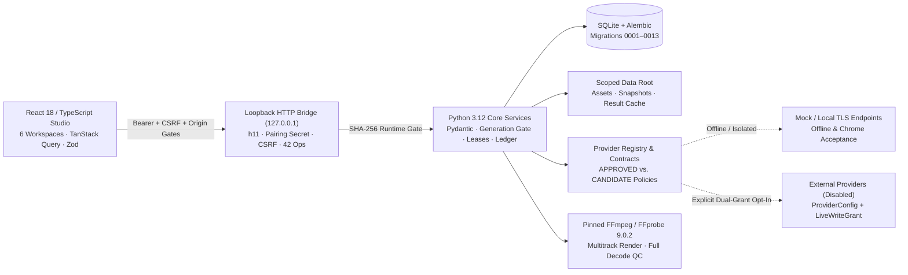
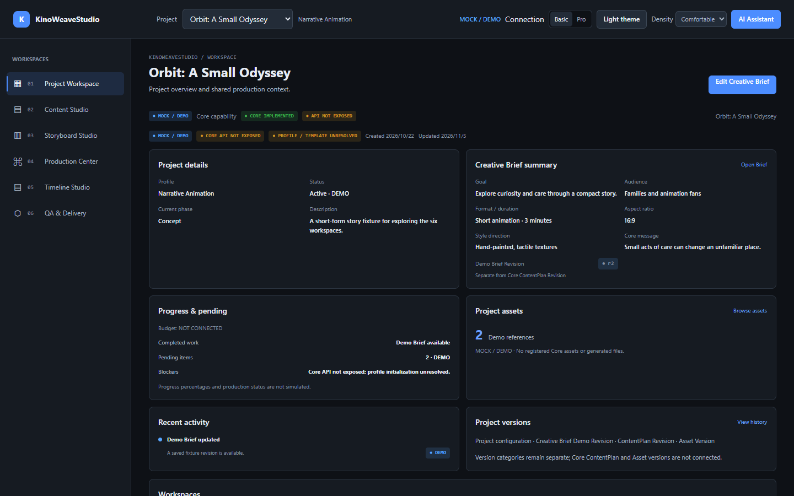
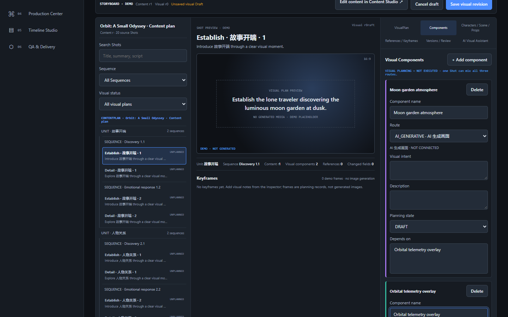
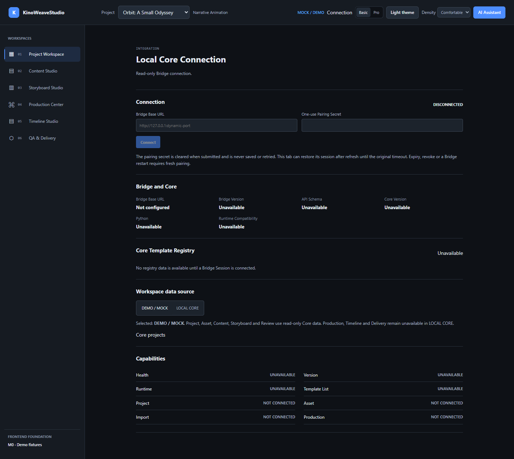
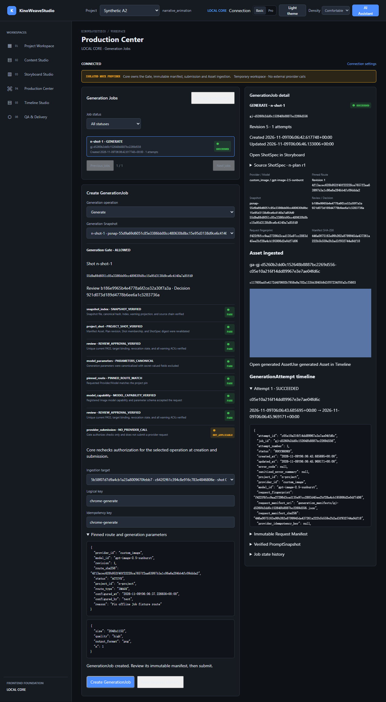
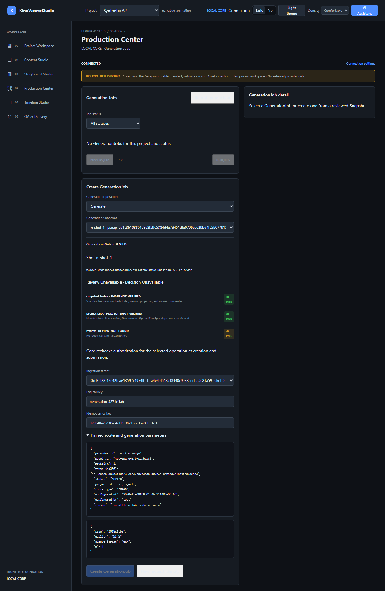
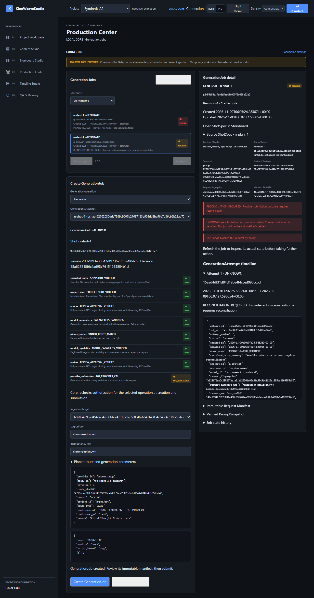
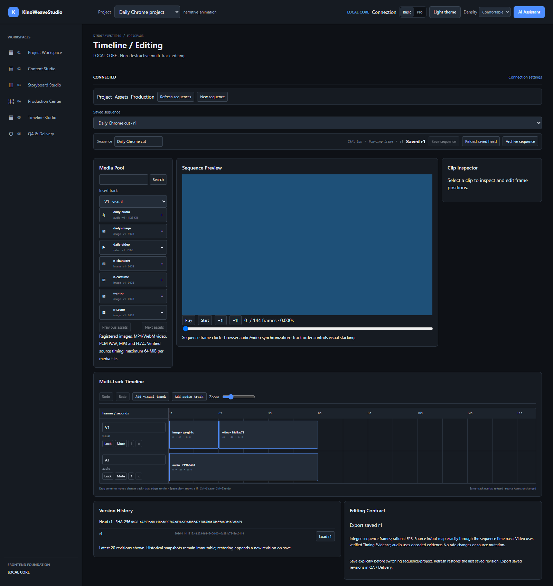
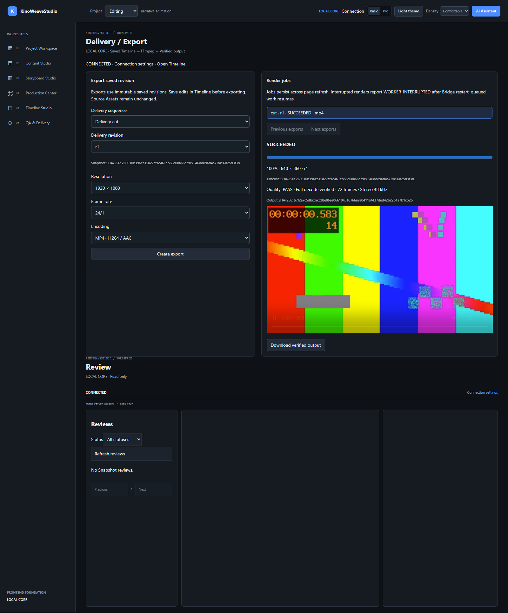

# KinoWeave Studio · Showcase

**A deterministic, local-first control plane for AI-assisted video production** — connecting structured planning, versioned ShotSpecs, fail-closed Generation Gates, asynchronous multi-provider orchestration, content-addressed assets, non-destructive multi-track editing, and FFmpeg-verified delivery.

> **Evaluation Context**: This public repository (`KinoWeaveStudio-Showcase`) was assembled from the private `KinoWeaveStudio` codebase to provide **verifiable engineering evidence** (real UI walkthrough, real Chrome acceptance captures, live test runs, and curated code excerpts) for **Devin Bots credits evaluation**.
>
> **Strict Honesty & Safety Notice**: **0 paid Provider API calls** were executed for this showcase. All screenshots, video recordings, and test results strictly separate `DEMO / MOCK` exploration mode, `LOCAL CORE` offline / local-TLS acceptance runs, and default-disabled `LIVE PROVIDER` integration. All credentials, internal endpoints, local user paths, and private creative scripts have been removed or omitted.

---

## Operating Modes & Truthfulness Matrix

KinoWeave Studio enforces hard architectural boundaries between UI exploration, offline acceptance, and real billable API execution—never silently falling back between modes:

| Mode | Backing Engine | Network / Paid APIs | Purpose & Boundary |
| --- | --- | --- | --- |
| **`DEMO / MOCK`** | Browser `mockAdapter` + `localStorage` fixtures | **None** (`http://127.0.0.1` UI only) | Interactive React Studio walkthrough across all 6 workspaces. Explicitly displays `CORE API NOT EXPOSED` / `NO MEDIA GENERATED` banners. |
| **`LOCAL CORE` (Offline / Local TLS)** | Python Core + `h11` Loopback Bridge + SQLite + Pinned FFmpeg `9.0.2` | **Localhost / Local TLS test endpoints only** (`0` paid API calls) | End-to-end engineering acceptance: real Bridge HTTP, one-use pairing secrets, CSRF, 7-check Generation Gate, Job/Attempt leases, safe staging, non-destructive Timeline revisions, and decoded FFmpeg MP4/WebM export. |
| **`LIVE PROVIDER`** | Python Core + Bridge + Real Vendor Transports | **Default DISABLED** | Requires **two** independent authorization files (`ProviderConfig` + `LiveWriteGrant`), per-modality scope (`IMAGE` vs. `VIDEO`), named env var secrets, integer minor-unit budget caps, and explicit `download_hosts`. |

---

## System Architecture

- **Deep Dive**: See [docs/ARCHITECTURE.md](docs/ARCHITECTURE.md) for trust boundaries, database migrations (`0001`–`0013`), cache-first recovery, bounded log redaction, and quiesced backup/restore.

---

## 90–120s Demo Video & Real Application Screenshots

- **Demo Recording (104.20s, 1280×720 H.264)**: [demo/kinoweave-studio-demo.mp4](demo/kinoweave-studio-demo.mp4)
- **Synchronized English Subtitles (16 cues)**: [demo/kinoweave-studio-demo.srt](demo/kinoweave-studio-demo.srt)
- **Technical Brief & Recording Script**: [demo/TECHNICAL_BRIEF.md](demo/TECHNICAL_BRIEF.md) · [demo/MANUAL_RECORDING_SCRIPT.md](demo/MANUAL_RECORDING_SCRIPT.md)

### Part A — Live React Studio UI (`DEMO / MOCK` Mode, Captured Live in Desktop Chrome)

| Project Workspace & Shared Context | Content Studio (Units / Sequences / Shots) |
| --- | --- |
|  |  |
| **Storyboard Studio (ShotSpec & Mixed Visual Routes)** | **Local Core Connection & Isolation Boundaries** |
|  |  |

### Part B — Authenticated `LOCAL CORE` + Bridge HTTP + FFmpeg Acceptance (Offline / Local TLS)

| 7-Check Generation Gate `PASS` → Ingested Asset | Fail-Closed Gate `DENIED` (`REVIEW_NOT_FOUND`) |
| --- | --- |
|  |  |
| **`UNKNOWN` Non-Retry Guard (`RECONCILIATION_REQUIRED`)** | **Content-Addressed Project & Asset Browser** |
|  |  |
| **Non-Destructive Multi-Track Timeline (`V1`/`A1`, Rational FPS)** | **Pinned FFmpeg 9.0.2 H.264/AAC Delivery & Decode QC** |
|  |  |

*(In `09-core-timeline-multitrack.png`, a test-harness `<video>` tag appended below the application footer in the original full-page E2E capture was cropped out below the bottom border; the entire Studio UI viewport is unaltered.)*

---

## Core Engineering Pillars & Code Excerpts

The `snippets/` directory contains sanitized, syntax-verified Python excerpts directly from KinoWeave Core:

1. **Multi-Provider Capability Contracts & Versioned Output Policies** — [snippets/01_provider_contracts.py](snippets/01_provider_contracts.py)
   - `ProviderRegistry.resolve()` enforces strict `(provider_id, model_id, modality)` pinning with **zero silent fallback**.
   - `ContractRecord` and `OutputPolicy.evaluate()` separate `APPROVED` contracts from `CANDIDATE` rules (e.g., native provider audio or relaxed frame bounds require explicit human acceptance) and enforce full decode + CFR timing verification.
2. **Fail-Closed Generation Gate & Async Video Orchestration** — [snippets/02_generation_gate_and_async_video.py](snippets/02_generation_gate_and_async_video.py)
   - Pre-flight `GenerationGateVerifier` validates Snapshot SHA-256, Project/Shot membership, unrevoked Review approvals with Warning ACKs, pinned route matching, and rejects secret-keyed generation parameters (`PARAMETER_SECRET_NOT_ALLOWED`).
   - `AsyncVideoOrchestratorExcerpt` locks each `GenerationJob` to its pinned `provider_config` identity, consumes budget reservations before a single external submit (`SDK_SUBMISSION_STARTED`), and forces ambiguous errors into `UNKNOWN` / `RECONCILIATION_REQUIRED` with `automatic_retries: 0`.
3. **Zero-Network Cache Recovery & Anti-SSRF Downloader** — [snippets/03_cache_and_safe_download.py](snippets/03_cache_and_safe_download.py)
   - `VideoResultReceipt` binds staged media bytes to exact `(project_id, job_id, attempt_id, task_id, manifest_sha256, contract_sha256, endpoint_sha256, source_sha256)` so recovery works completely offline without opening transports or reading secrets.
   - `validate_download_destination()` and `public_address()` reject non-HTTPS URLs, unlisted hosts, credentials in URLs, and loopback/private/mapped IP targets under a bounded DNS semaphore.
4. **Non-Destructive Frame-Exact Timeline Model** — [snippets/04_nondestructive_timeline.py](snippets/04_nondestructive_timeline.py)
   - `EditingDocument` enforces normalized rational `FrameRate(num, den)`, non-overlapping intervals, still-image zero `source_in`, and registered Asset SHA-256 immutability with optimistic concurrency (`expected_revision`).

---

## Reproducible Verification Evidence

Live verification executed on **`2026-11-20`** is kept **strictly separate** from the historical frozen closure baseline (`724f79b`, `2026-11-11`). Full command logs and explanations live in [evidence/TEST_VERIFICATION.md](evidence/TEST_VERIFICATION.md).

| Check Scope | Run Date / Commit | Measured Result | Notes |
| --- | --- | --- | --- |
| **Representative Core Backend Suite** (17 `pytest` files) | **Live · 2026-11-20** | **253 passed, 1 skipped, 0 failed** (`409.09s`) | Covers contracts, policies, gates, jobs, async video, cache, recovery, Pixstag/Seedance adapters, editing, delivery, backup/restore, logging, grants. Skip = Windows unprivileged symlink test. |
| **Frontend TypeScript + Vitest** (`test-frontend.ps1`) | **Live · 2026-11-20** | **128 passed / 20 files**, `tsc` 0 errors (`22.80s`) | Real component & state-machine tests for Bridge client, Production boundaries, Timeline model, Storyboard, Content. |
| **Frontend Production Build** (`build-ui.ps1`) | **Live · 2026-11-20** | **PASS** (`301` modules, `1.68s`) | Clean Vite bundle (`tsc -b && vite build`). |
| **Demo MP4 FFprobe + Full Decode** | **Live · 2026-11-20** | **PASS** (`104.20s`, `1280x720`, `0` decode errors) | Verified with pinned FFmpeg / FFprobe `9.0.2`. |
| **Bridge `verify_runtime()` Integrity Gate** | **Live · 2026-11-20** | **Fail-Closed `503 RUNTIME_UNAVAILABLE`** | Expected: `core_identity.json` is pinned to frozen `724f79b` while working tree is at `b31e426` with active Core/integration edits—proving runtime tamper/drift detection blocks socket binding. |
| **Full Backend Regression (Frozen Baseline)** | Historical · `724f79b` (`2026-11-11`) | **1,818 PASS / 3 SKIP / 0 FAIL** (`1:17:59`) | Frozen pre-integration closure baseline; includes real Bridge HTTP, new-root Chrome E2E, cache recovery, and 30-file backup/restore drill. |

---

## Devin Bots Parallel Engineering Roadmap (5 Scoped Workstreams)

KinoWeave Studio's decoupled module ownership and offline test harnesses allow **five Devin Bots** to execute concurrently without interfering with each other or calling paid APIs. Full specifications, target files, and pytest/Vitest verification gates are documented in [docs/DEVIN_BOTS_ROADMAP.md](docs/DEVIN_BOTS_ROADMAP.md):

| # | Workstream | Primary Modules | Verification Gate |
| --- | --- | --- | --- |
| **1** | **Multi-Provider Contract Matrix & Error Taxonomy** | `model_contracts.py`, `providers.py` | `pytest test_model_contracts.py test_providers_templates.py test_video_provider_contract.py` |
| **2** | **Async Video Recovery & Ledger Reconciliation CLI** | `video_recovery.py`, `video_result_cache.py`, `recover_cached_video.py` | `pytest test_video_recovery.py test_video_cache.py test_offline_video_runtime.py` |
| **3** | **Bridge OpenAPI v1 & TypeScript/Zod Schema Parity** | `kinoweave_bridge/contract.py`, `openapi-v1.yaml`, `*Contracts.ts` | `pytest tests/bridge/test_contract.py` + `npm run typecheck && npm test` |
| **4** | **Timeline Keyboard Snapping & Audio Peak Visualization** | `CoreTimelinePage.tsx`, `coreEditingModel.ts` | `./scripts/test-frontend.ps1` + `./scripts/build-ui.ps1` |
| **5** | **Headless Offline CI Evidence Pack & Identity Gate** | `run_offline_tests.py`, `verify_integrity.py`, `playwright.product.config.ts` | `pytest test_readiness_operations.py test_backup_restore.py` + `test-frontend.ps1` |

---

## Known Limitations & Honest Readiness Boundaries

- **Web Authoring / Approval Scope**: Web Content Studio, Storyboard, and Review are read-only in `LOCAL CORE` mode; content registration, `PromptSnapshot` creation, and human approvals execute via trusted local CLI.
- **Candidate Model Contracts**: Certain vendor behaviors (e.g., Pixstag native audio / variable frame counts, Huoshen `Edit`, `gpt-image-2.6-sunburst` billing/capabilities) remain `CANDIDATE` or `UNVERIFIED` until controlled live verification.
- **Non-AI Visual Routes**: `CODE_GRAPHICS` and `THREE_D` exist as schema and semantic planning contracts, not general-purpose motion-graphics or 3D rendering engines.
- **Deployment Scope**: Built for trusted single-operator local production (`127.0.0.1` loopback Bridge, `200`-asset/clip per-sequence bounds, single delivery worker per Data Root); multi-tenant authentication, public TLS termination, and cloud observability are future work.
- **Working-Tree Bridge Pin**: Because active integration work (`b31e426` + uncommitted edits) has not yet been re-frozen into `core_identity.json`, the Bridge fails closed with `RUNTIME_UNAVAILABLE` until the Core identity manifest is updated on clean LF bytes.

---

## Showcase Audit & Licensing

- **Security & Desensitization Audit**: [SECURITY_AUDIT.md](SECURITY_AUDIT.md)
- **Public Showcase & Copyright Notice**: [NOTICE.md](NOTICE.md)
