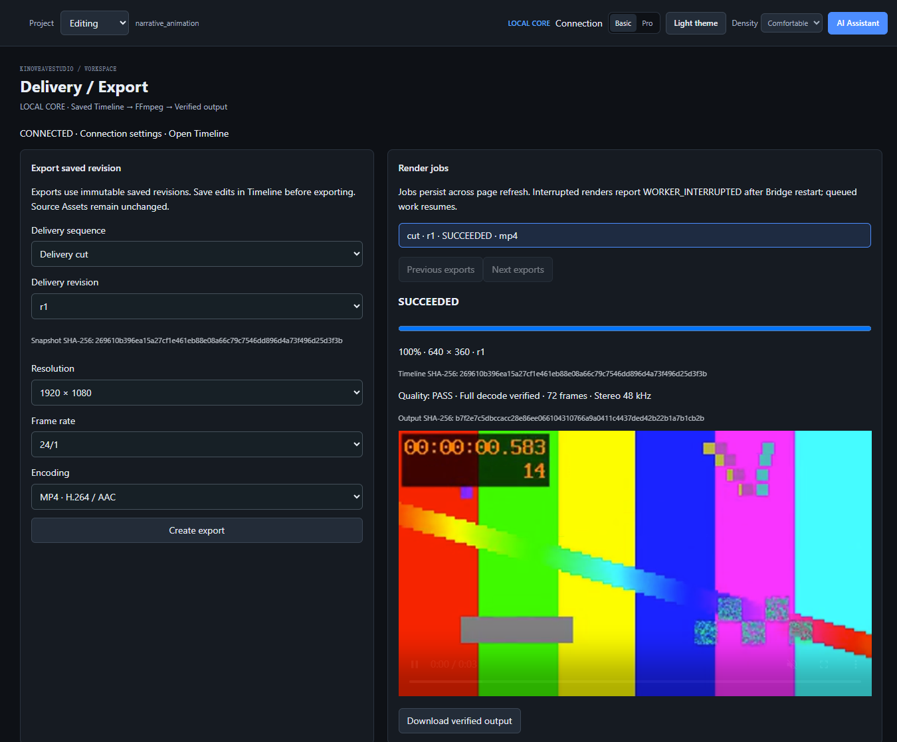
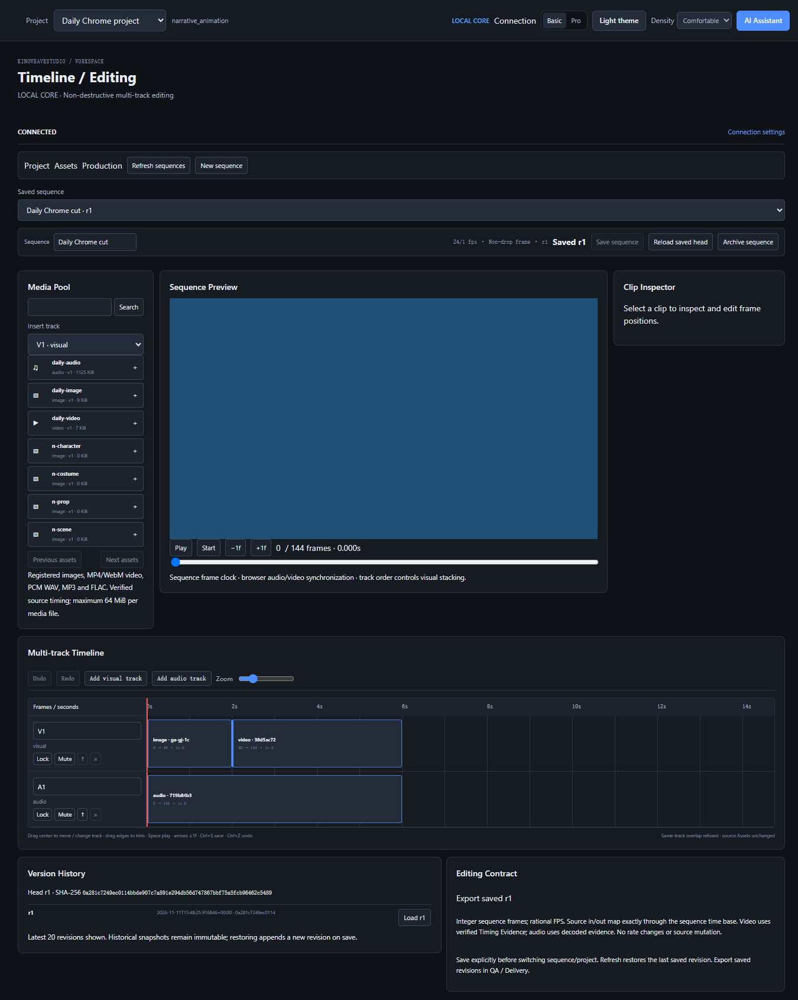
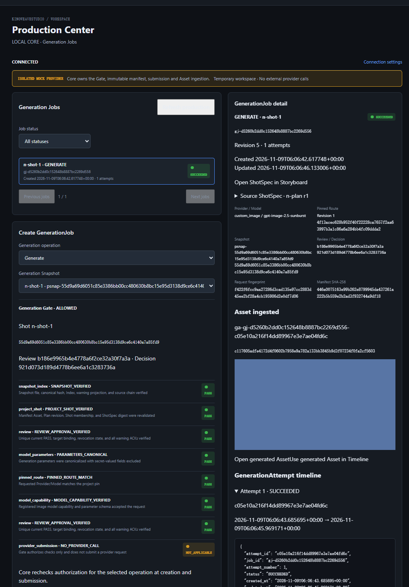
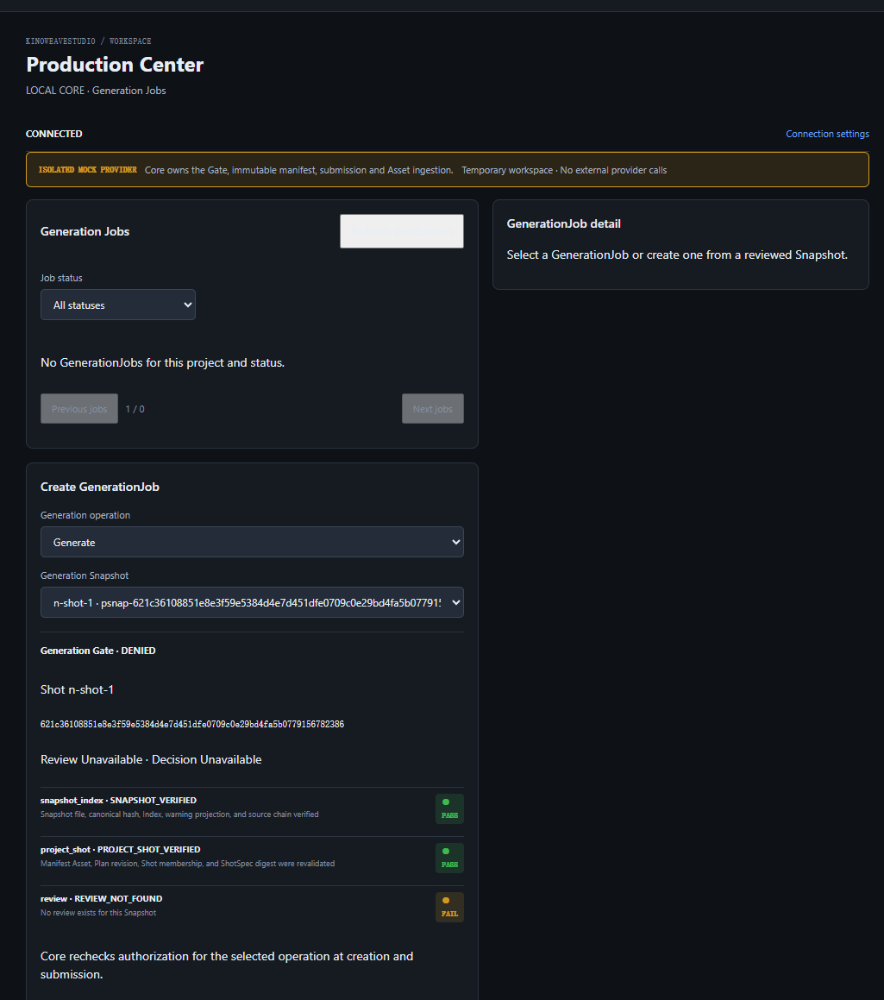
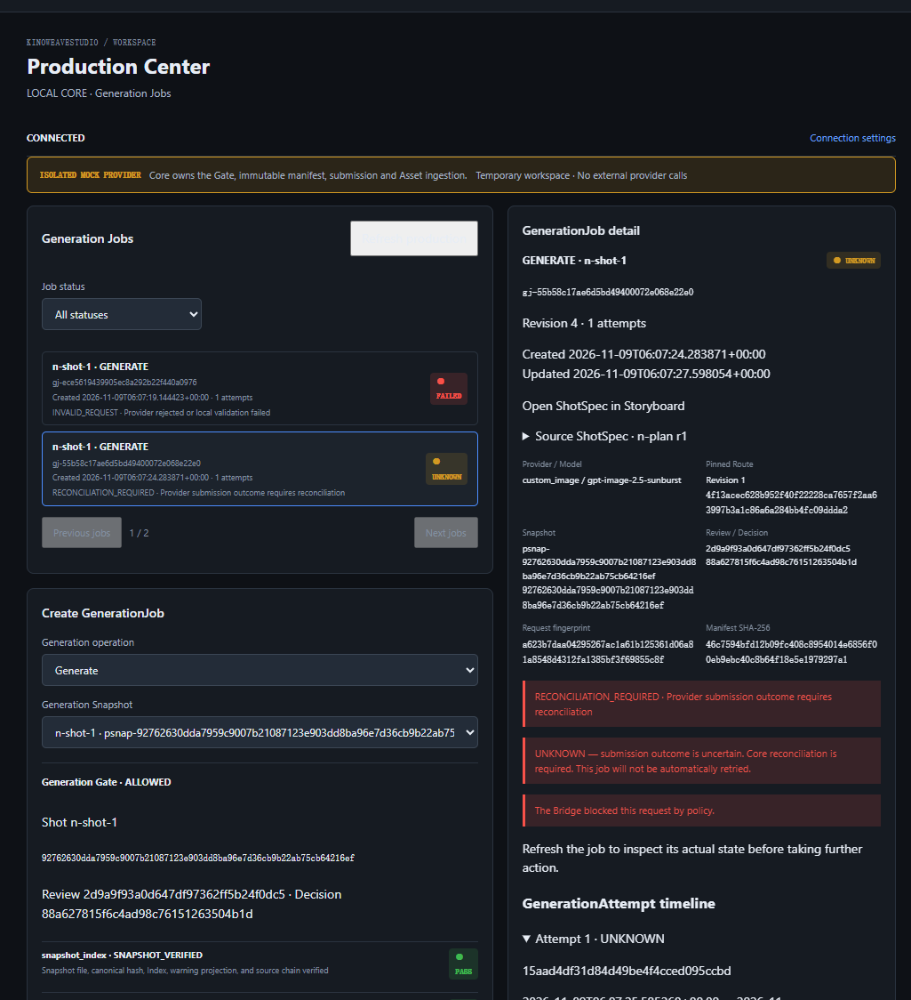
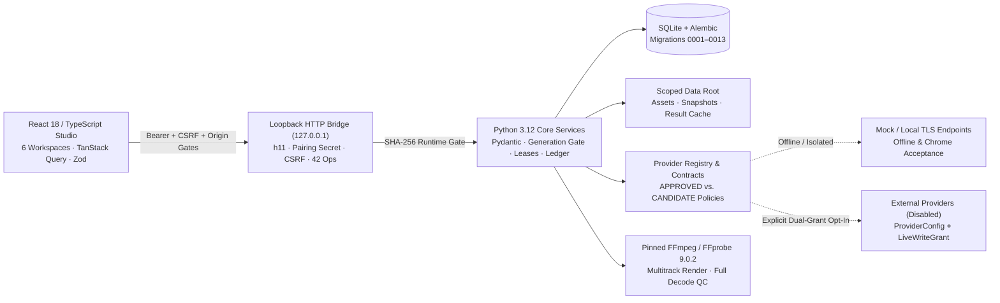
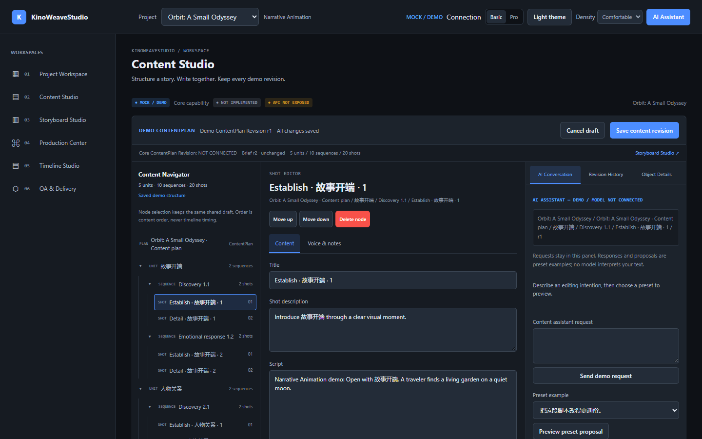
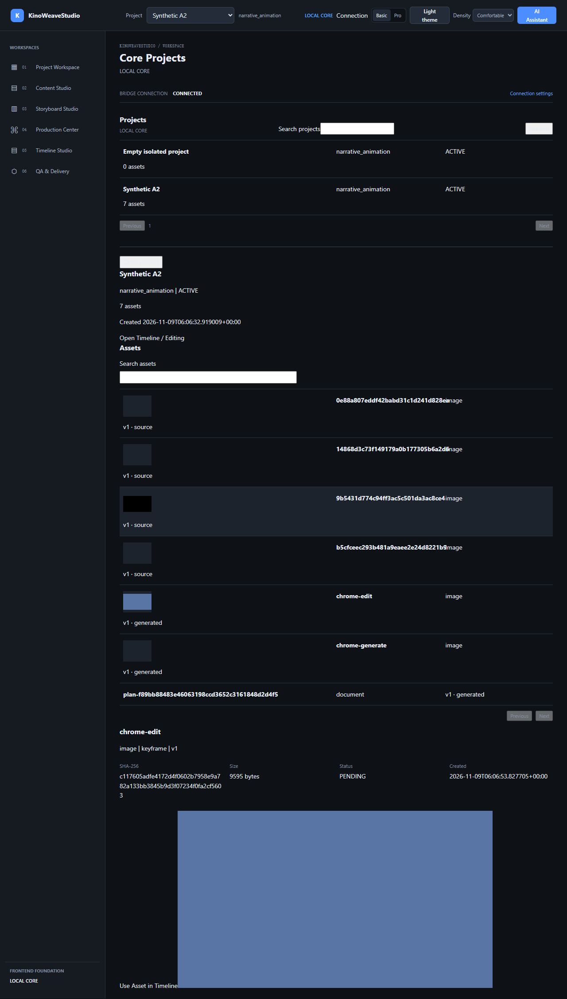

# KinoWeave Studio · Public Engineering Showcase

**Deterministic Local-First AI Video Production Control Plane** — connecting structured planning, versioned `ShotSpec` / `PromptSnapshot` hashing, fail-closed Generation Gates, asynchronous multi-provider orchestration, content-addressed assets, non-destructive multi-track editing, and `FFmpeg`-verified delivery.

> **Public Evidence Repository (Not a Standalone Runnable Release)**  
> `KinoWeaveStudio-Showcase` is a **public, desensitized engineering evidence repository** derived from the private `KinoWeave Studio` codebase for **Poke / Devin Bots credits evaluation**. It is **not** a runnable open-source release of the full private application: full source code, internal deployment configs, SQLite databases, API keys, and private production scripts are deliberately withheld. **0 paid Provider API calls** were made to generate any artifact or test result here.

**Quick Reviewer Links**: [104s Demo Video (MP4)](demo/kinoweave-studio-demo.mp4) · [English Subtitles (SRT)](demo/kinoweave-studio-demo.srt) · [5 Parallel Devin Bots Tasks](docs/DEVIN_BOTS_ROADMAP.md) · [Verification Logs](evidence/TEST_VERIFICATION.md) · [Security Audit](SECURITY_AUDIT.md)

---

## 1. Verified `LOCAL CORE` Runtime Evidence & Latest Test Results

The captures below come from **real Desktop Chrome** talking to **real Python Core + authenticated loopback Bridge HTTP + SQLite + pinned `FFmpeg 9.0.2`** under isolated mock / local-TLS provider transports (`0` paid API calls). Zoomed full-width crops highlight readability while linking directly to every untouched original screenshot.

### 1.1 Pinned `FFmpeg 9.0.2` Delivery, Full-Decode QC & Verified SMPTE Playback

Exporting an immutable saved Timeline revision (`r1`) produces an H.264/AAC MP4 verified via full-stream decode (`72 frames`, `Stereo 48 kHz`, `Quality: PASS`) and exact `Output SHA-256` matching in the browser.

- Untouched full-page original: [10-core-delivery-ffmpeg-verified.png](assets/screenshots/10-core-delivery-ffmpeg-verified.png)

---

### 1.2 Non-Destructive Multi-Track Timeline (`V1`/`A1`, Rational FPS, SHA-256 Revisions)

Frame-accurate editing across visual (`V1`) and audio (`A1`) tracks using content-addressed registered assets (`daily-image`, `daily-video`, `daily-audio`), immutable revision snapshots (`Saved r1`), and zero mutation of source media.

- Untouched original (cropped only at `y=1694` below the app footer to strip an appended test-harness `<video>` element): [09-core-timeline-multitrack.png](assets/screenshots/09-core-timeline-multitrack.png)

---

### 1.3 Seven-Check Generation Gate & Fail-Closed `UNKNOWN` Non-Retry Guards

Before any job can submit, Core evaluates snapshot integrity, shot binding, unrevoked human review with Warning ACKs, parameter canonicalization (rejecting secret-keyed fields), and project-pinned routes.

- Untouched full-page original: [05-core-production-gate-pass.png](assets/screenshots/05-core-production-gate-pass.png) · Related Asset browser: [08-core-projects-assets.png](assets/screenshots/08-core-projects-assets.png)

<strong>Inspect Fail-Closed Gate Rejection (<code>REVIEW_NOT_FOUND</code>) &amp; <code>UNKNOWN</code> Non-Retry Reconciliation Captures (Full Width)</strong>

#### Fail-Closed Gate Rejection — Unreviewed Snapshot Denied (`REVIEW_NOT_FOUND`)

- Untouched original: [06-core-production-gate-denied.png](assets/screenshots/06-core-production-gate-denied.png)

#### Uncertain Submission Boundary — `UNKNOWN` Forces `RECONCILIATION_REQUIRED` (Never Auto-Retried)

- Untouched original: [07-core-production-unknown-reconcile.png](assets/screenshots/07-core-production-unknown-reconcile.png)

---

### 1.4 Latest Verification Summary (`2026-11-20` Live Runs vs. Frozen `724f79b` Baseline)

Live verification run directly on **`2026-11-20`** is reported separately from the frozen **`724f79b`** closure baseline—counts across separate runs and commits are never combined. Full command logs live in [evidence/TEST_VERIFICATION.md](evidence/TEST_VERIFICATION.md).

| Verification Scope | Run / Commit | Result | Notes |
| --- | --- | --- | --- |
| **Core Backend Representative Suite** (`17` pytest files) | **Live · 2026-11-20** | **253 passed, 1 skipped, 0 failed** (`409.09s`) | Covers contracts, policies, gates, jobs, async video, cache, recovery, Pixstag/Seedance adapters, editing, delivery, backup/restore, logging, grants. Skip = Windows unprivileged symlink test. |
| **Targeted Delivery & Model Regression** (`2` pytest files) | **Live · 2026-11-20** | **4 passed, 0 failed** (`2.62s`) | `test_delivery_frame_boundaries.py`, `test_image_default_model.py`. |
| **Frontend Typecheck + Vitest** (`test-frontend.ps1`) | **Live · 2026-11-20** | **128 passed / 20 files**, `tsc` 0 errors (`22.80s`) | Real Bridge client, Production boundaries, Timeline model, Storyboard, Content tests. |
| **Frontend Production Build** (`build-ui.ps1`) | **Live · 2026-11-20** | **PASS** (`301` modules, `1.68s`) | Clean `tsc -b && vite build` bundle. |
| **Demo MP4 FFprobe + Full Decode** | **Live · 2026-11-20** | **PASS** (`104.20s`, `1280x720`, `0` errors) | Verified with pinned `FFmpeg / FFprobe 9.0.2`. |
| **Full Backend + Chrome Bridge E2E (Frozen Baseline)** | Historical · `724f79b` | **1,818 PASS / 3 SKIP / 0 FAIL** + Chrome E2E **PASS** | Historical closure baseline (`DAILY_WORKFLOW_FINAL_CLOSURE_REPORT.md`): real Bridge HTTP, new persistent root, local TLS APIs, 30-file backup/restore drill. |

> **Bridge Runtime Integrity Status (`503 RUNTIME_UNAVAILABLE`)**: Historical real-HTTP Bridge E2E (`playwright.daily.config.ts`) passed on the frozen `724f79b` baseline. On the active development working tree (`b31e426` plus active uncommitted Core/integration edits), `verify_runtime()` intentionally returns **`503 RUNTIME_UNAVAILABLE`** because `core_identity.json` has not yet been re-pinned to the updated Core bytes—confirming that the fail-closed runtime guard blocks unpinned execution before opening any socket.

---

## 2. Five Parallel Devin Bots Engineering Workstreams

KinoWeave Studio's clean separation between Python Core, Loopback Bridge, and React Studio—backed by offline `pytest`, `Vitest`, and `Playwright` test harnesses—lets **five Devin Bots** execute concurrently with **disjoint file ownership** and **zero paid API spend**. Full deliverable specs and commands live in [docs/DEVIN_BOTS_ROADMAP.md](docs/DEVIN_BOTS_ROADMAP.md):

| Bot | Parallel Engineering Task | Disjoint Module Scope | Concrete Deliverables | Automated Offline Gate |
| --- | --- | --- | --- | --- |
| **#1** | **Multi-Provider Contract Matrix & Error Taxonomy** | `src/kinoweave/model_contracts.py`, `providers.py`, contract tests | Unified parameter JSON Schema matrix validator + deterministic error classifier (`AUTH`, `QUOTA`, `RATE_LIMIT`, `INVALID_INPUT`, `POLICY`, `UNKNOWN`) preserving `CANDIDATE` isolation. | `pytest test_model_contracts.py test_providers_templates.py test_video_provider_contract.py` |
| **#2** | **Async Video Recovery & Ledger Reconciliation CLI** | `src/kinoweave/video_recovery.py`, `video_result_cache.py`, `scripts/recover_cached_video.py` | Machine-readable reconciliation report for `UNKNOWN` / `RECONCILIATION_REQUIRED` jobs + fault-injection tests with mocked socket prohibition. | `pytest test_video_recovery.py test_video_cache.py test_offline_video_runtime.py` |
| **#3** | **Bridge OpenAPI v1 & TypeScript/Zod Schema Parity** | `src/kinoweave_bridge/contract.py`, `docs/bridge/openapi-v1.yaml`, `*Contracts.ts` | Automated parity test across all `42` Bridge operations verifying HTTP methods, query/body bounds, error codes, and lifecycle enums match OpenAPI & Zod schemas. | `pytest tests/bridge/test_contract.py` + `npm run typecheck && npm test` |
| **#4** | **Timeline Keyboard Snapping & Audio Peak Visualization** | `apps/studio-ui/src/workspaces/timeline/CoreTimelinePage.tsx`, `coreEditingModel.ts` | Pure frame-grid/playhead snapping helper (fractional FPS safe), NLE keyboard nudging, and client-side PCM peak waveform rendering without mutating source files. | `./scripts/test-frontend.ps1` + `./scripts/build-ui.ps1` |
| **#5** | **Headless Offline CI Evidence Pack & Identity Gate** | `scripts/run_offline_tests.py`, `verify_integrity.py`, `playwright.product.config.ts` | One-command offline CI pipeline emitting sanitized JSON/JUnit summaries + CRLF/binary-safe `core_identity.json` drift checker. | `pytest test_readiness_operations.py test_backup_restore.py` + `test-frontend.ps1` |

---

## 3. System Architecture & Operating Boundaries

KinoWeave Studio enforces strict separation between UI exploration (`DEMO / MOCK`), isolated offline acceptance (`LOCAL CORE`), and opt-in billable providers (`LIVE PROVIDER`):

| Mode | Backing Engine | Network / Paid APIs | Purpose & Guardrail |
| --- | --- | --- | --- |
| **`DEMO / MOCK`** | Browser `mockAdapter` + `localStorage` fixtures | **None** (`127.0.0.1` UI only) | Interactive 6-workspace exploration. Explicitly displays `CORE API NOT EXPOSED` / `NO MEDIA GENERATED` banners. |
| **`LOCAL CORE`** (Offline / Local TLS) | Python 3.12 Core + `h11` Loopback Bridge + SQLite + Pinned `FFmpeg 9.0.2` | **Localhost / Local TLS only** (`0` paid calls) | Real Bridge HTTP, one-use pairing secrets, CSRF, 7-check Generation Gate, Job/Attempt leases, safe staging, Timeline revisions, and FFmpeg MP4/WebM QC. |
| **`LIVE PROVIDER`** | Python Core + Bridge + Vendor Transports | **Default DISABLED** | Requires **two** independent authorization files (`ProviderConfig` + `LiveWriteGrant`), per-modality scope, named env var secrets, integer minor-unit budget caps, and `download_hosts` allowlists. |

- **Full Architecture Reference**: [docs/ARCHITECTURE.md](docs/ARCHITECTURE.md) (trust boundaries, `0001`–`0013` migrations, bounded log redaction, quiesced backup/restore).

---

## 4. Core Engineering Excerpts (`snippets/`)

All files in `snippets/` are read-only, syntax-verified Python excerpts extracted directly from KinoWeave Core:

1. **Multi-Provider Capability Contracts & Output Policies** — [snippets/01_provider_contracts.py](snippets/01_provider_contracts.py)  
   `ProviderRegistry.resolve()` enforces strict `(provider_id, model_id, modality)` pinning with zero silent fallback; `OutputPolicy.evaluate()` gates `CANDIDATE` behaviors behind explicit acceptance and full decode/CFR timing checks.
2. **Fail-Closed Generation Gate & Async Video Orchestration** — [snippets/02_generation_gate_and_async_video.py](snippets/02_generation_gate_and_async_video.py)  
   Rejects secret-keyed generation parameters (`PARAMETER_SECRET_NOT_ALLOWED`), pins `GenerationJob` execution to immutable `provider_config` digests, consumes budget reservations before external submission, and transitions uncertain outcomes to `UNKNOWN` / `RECONCILIATION_REQUIRED` (`automatic_retries: 0`).
3. **Zero-Network Cache Recovery & Anti-SSRF Downloader** — [snippets/03_cache_and_safe_download.py](snippets/03_cache_and_safe_download.py)  
   Binds downloaded bytes via `VideoResultReceipt` to exact Job/Attempt/Manifest/Contract/SHA-256 identities so recovery works completely offline, while `validate_download_destination()` enforces HTTPS host allowlists, bounded DNS resolution, and public-IP checks.
4. **Non-Destructive Frame-Exact Timeline Model** — [snippets/04_nondestructive_timeline.py](snippets/04_nondestructive_timeline.py)  
   Validates normalized rational `FrameRate(num, den)`, non-overlapping intervals, still-image zero `source_in`, and registered Asset SHA-256 immutability under optimistic concurrency (`expected_revision`).

---

## 5. Live 104s Demo Video & React Studio UI Captures (`DEMO / MOCK`)

- **Video Walkthrough (`104.20s`, `1280×720` H.264)**: [demo/kinoweave-studio-demo.mp4](demo/kinoweave-studio-demo.mp4)
- **English Subtitles & Scripts**: [kinoweave-studio-demo.srt](demo/kinoweave-studio-demo.srt) · [TECHNICAL_BRIEF.md](demo/TECHNICAL_BRIEF.md) · [MANUAL_RECORDING_SCRIPT.md](demo/MANUAL_RECORDING_SCRIPT.md)

<strong>More Full-Width Screenshots (Content Studio, Storyboard Visual Routes &amp; Core Asset Browser)</strong>

---

## 6. Known Limitations, Audit & Notice

- **Web Authoring / Approval Boundaries**: Web Content Studio, Storyboard, and Review are read-only in `LOCAL CORE`; content registration, `PromptSnapshot` creation, and human approvals execute through trusted local CLI.
- **Candidate & Unverified Provider Paths**: Selected model contracts (e.g., Pixstag native audio / variable frame counts, Huoshen `Edit`, `gpt-image-2.6-sunburst` pricing/identity) remain `CANDIDATE` or `UNVERIFIED`.
- **Visual Routes & Deployment Scope**: `CODE_GRAPHICS` and `THREE_D` are schema/semantic contracts rather than complete renderers; Bridge targets single-operator loopback workflows (`127.0.0.1`) rather than multi-tenant cloud hosting.
- **Security Audit & Showcase Notice**: [SECURITY_AUDIT.md](SECURITY_AUDIT.md) · [NOTICE.md](NOTICE.md)
