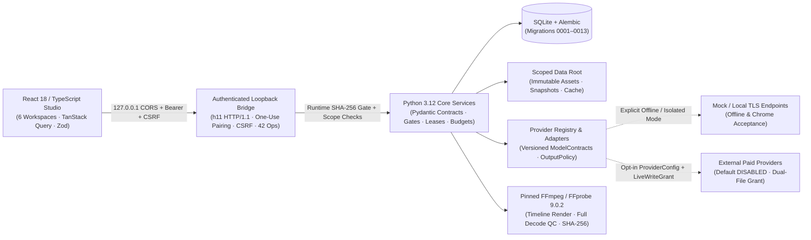

# KinoWeave Studio — System Architecture & Trust Boundaries

KinoWeave Studio is a **local-first, deterministic AI video production control plane** built as a modular monolith with strict separation between creative intent (author / AI assistant) and deterministic system authority (Python Core).

---

## 1. Layered System Topology



### Component Responsibilities

| Layer | Technology | Responsibility & Security Invariants |
| --- | --- | --- |
| **Python Core** | Python 3.12.14, Pydantic 2, SQLAlchemy 2, Alembic | Owns ContentPlans, ShotSpecs, immutable PromptSnapshots, human Review decisions, 7-check Generation Gates, Job/Attempt leases, integer minor-unit budget ledgers, task-bound recovery caches, non-destructive timelines, and FFmpeg delivery QC. |
| **Loopback Bridge** | `h11` HTTP/1.1, custom `BridgeApp` / `BridgeServer` | Listens exclusively on `127.0.0.1`; verifies exact SHA-256 bytes of every Core source file (`core_identity.json`) and lockfile (`requirements-dev.lock`) **before binding any socket**. Enforces one-use 43-char pairing secrets, `Origin`/`Host`/`Sec-Fetch-*` checks, `X-KinoWeave-CSRF`, per-minute rate limits, and 42 registered operations. |
| **React Studio UI** | React 18.3, TypeScript 5.8, Vite 6.4, TanStack Query 5, Zod 4 | Implements six integrated workspaces sharing one Project Context. Explicitly isolates `DEMO / MOCK` exploration mode from `LOCAL CORE` mode—never silently falling back to fake data when Bridge is disconnected or read-only. |
| **Media Runtime** | Pinned FFmpeg & FFprobe `9.0.2` | Executable paths and hashes are pinned locally; never accepts arbitrary CLI arguments or client-supplied output paths. Performs full stream decode checks, frame-count verification, PCM sample validation, and output SHA-256 hashing. |

---

## 2. Core Data & Deterministic Production Pipeline

```text
Author / CLI Prep
  └─▶ Versioned ContentPlan (4 profiles)
        └─▶ ShotSpec + VisualPlan (AI_GENERATIVE / CODE_GRAPHICS / THREE_D)
              └─▶ Immutable PromptSpec → PromptSnapshot (SHA-256 verified)
                    └─▶ Human Review + Warning ACK (CLI-owned, read-only in Web)
                          └─▶ 7-Check Generation Gate + Project-Pinned Provider Route
                                └─▶ GenerationJob + Lease + Budget Reservation
                                      └─▶ Single-Flight Submit / Async Poll (UNKNOWN never retried)
                                            └─▶ Safe HTTPS Download / Task-Bound Cache / MediaProbe
                                                  └─▶ Asset Ingestion (Immutable SHA-256)
                                                        └─▶ Multi-Track Timeline Revisions (r1..rN)
                                                              └─▶ FFmpeg Delivery + Full Decode QC + SHA-256
```

### Key Architectural Properties

1. **Four Profiles, One Engine**:
   `narrative_animation`, `music_video`, `promotional_video`, and `science_educational` share the same versioned ContentPlan/ShotSpec schemas, PromptSnapshot hashing, Review bindings, Asset store, and Delivery pipeline while preserving domain-specific validation rules.
2. **Versioned Model Contracts & Output Policies**:
   Model capabilities (`src/kinoweave/model_contracts.py`) are versioned records with explicit evidence tags (`DOCUMENTED`, `OBSERVED`, `OFFLINE_VERIFIED`, `UNVERIFIED`) and lifecycle states (`APPROVED`, `CANDIDATE`, `RETIRED`). A `CANDIDATE` contract (such as native provider audio or relaxed frame-count tolerances) cannot execute without explicit human acceptance.
3. **Fail-Closed Async State Machine & Non-Retry `UNKNOWN`**:
   Before a single external submission crosses the network boundary, Core writes a durable budget reservation and transitions the Attempt to `SDK_SUBMISSION_STARTED`. Any ambiguous timeout or parse failure transitions to `UNKNOWN` / `RECONCILIATION_REQUIRED`—preventing duplicate paid charges from automatic retries.
4. **Anti-SSRF Video Downloads & Cache-First Zero-Network Recovery**:
   Video result downloads validate HTTPS-only URLs against explicit host allowlists, execute bounded DNS resolution under a concurrency semaphore, reject loopback/private/mapped IPs, and publish atomically into staging directories. Downloaded outputs write a task-bound `VideoResultReceipt` (`state/video-results/<job_id>/<attempt_id>.json`) so failed verification or worker restarts recover from local verified bytes with **zero network transports or credential reads**.
5. **Non-Destructive Frame-Exact Timeline & Delivery**:
   Timelines store rational frame rates (`FrameRate(num, den)`), non-overlapping clip intervals, and source Asset SHA-256 hashes. Source media files are never modified in place. Delivery workers render saved immutable revisions (`1` active worker per Data Root, max `4` queued/running jobs, max `64 MiB` per source, max `512 MiB` output) and require full decode + SHA-256 verification before publication.

---

## 3. Operational Boundaries & Safety Controls

- **Default Read-Only Data Roots**: Mounting a Data Root through the Bridge exposes read-only project/asset/content/storyboard/review inspection by default.
- **Separate Write Grants**:
  - `WorkspaceWriteGrant` authorizes bounded `TIMELINE` and `DELIVERY` operations (with persistent operation counters) on a named Data Root without granting AI generation authority.
  - `ProviderConfig` + `LiveWriteGrant` (plus explicit named environment variables) are *both* required to enable live AI Provider calls; `IMAGE` authorization never authorizes `VIDEO` and vice versa.
- **Bounded Logging & Redaction**: Rotating JSON logs under `<Data Root>/logs` enforce size/count/retention limits, reject symlinks/junctions, and strip secret-bearing keys (`authorization`, `cookie`, `csrf`, `token`, `secret`, `api_key`, prompts, signed URLs).
- **Quiesced Backup & Restore**: `scripts/operations.py backup --quiesced` snapshots SQLite, registered media, deliveries, result caches, provider ledgers, workspace counters, and contract identity into a SHA-256 manifest verified on restore.
